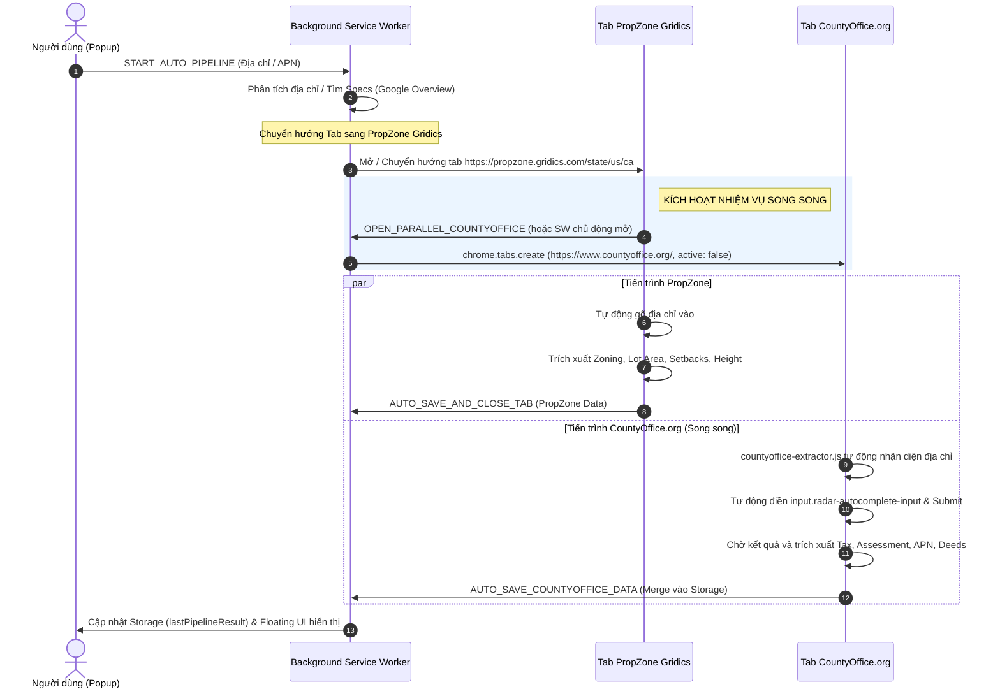

# Kế Hoạch: Chạy Song Song Tác Vụ Tìm Kiếm Thông Tin Trên CountyOffice.org

> **Phiên bản:** 1.0.0  
> **Áp dụng cho:** Extension Chrome `FEASIBILITY STUDY Data`  
> **Mục tiêu:** Khi tiến trình Auto Pipeline chạy tới bước PropZone (`propzone-map-extractor.js`), hệ thống sẽ song song mở thêm 1 tab truy cập `https://www.countyoffice.org/` để tự động tra cứu, trích xuất thông tin hồ sơ tài sản (Assessor/Property Records/Tax) mà không làm gián đoạn luồng PropZone chính.

---

## 1. Vị Trí Khởi Phát Sự Kiện (Enter / Click Fetch)

* **Giao diện HTML:** [popup/popup.html:L75-L84](file:///c:/Users/thailka/Desktop/SoftWare/Web/ExtensionsChrome/FEASIBILITY%20STUDY%20Data/popup/popup.html#L75-L84)
  * Ô nhập địa chỉ/APN: `<input type="text" id="input-address" class="search-input">`
  * Nút Fetch: `<button id="btn-auto-pipeline" class="btn-auto-pipeline">`
* **Xử lý sự kiện (Controller):** [popup/modules/pipeline-actions.js](file:///c:/Users/thailka/Desktop/SoftWare/Web/ExtensionsChrome/FEASIBILITY%20STUDY%20Data/popup/modules/pipeline-actions.js)
  * **Sự kiện gõ Enter (L183-L187):**
    ```javascript
    inputAddress.addEventListener("keyup", (e) => {
      if (e.key === "Enter" && btnAutoPipeline) {
        btnAutoPipeline.click();
      }
    });
    ```
  * **Sự kiện click Fetch (L209-L251):** Bắt sự kiện, kiểm tra địa chỉ, phát tín hiệu `chrome.runtime.sendMessage({ action: "START_AUTO_PIPELINE", address })`.

---

## 2. Kiến Trúc Luồng Chạy Song Song (Parallel Pipeline Architecture)



---

## 3. Các Thành Phần Cần Triển Khai Chi Tiết

### 3.1. Cấu hình Quyền & Content Script trong `manifest.json`
1. **Thêm Host Permission:**
   * `"https://www.countyoffice.org/*"`
2. **Đăng ký Content Script mới `content/countyoffice-extractor.js`:**
   ```json
   {
     "matches": ["https://www.countyoffice.org/*"],
     "js": [
       "content/floating-ui.js",
       "config/ca-cities-data.js",
       "config/county-detector.js",
       "config/rules.js",
       "content/countyoffice-extractor.js"
     ],
     "run_at": "document_idle"
   }
   ```

---

### 3.2. Điểm Kích Hoạt Mở Tab Song Song
Có 2 điểm kích hoạt hỗ trợ lẫn nhau để đảm bảo độ tin cậy 100%:
* **Cách kích hoạt chính (tại `service-worker.js`):**
  Trong hàm `handlePropertyOverviewFound(...)`, ngay khi xác định chuyển hướng tab sang PropZone, gọi mở thêm 1 tab chạy nền (hoặc tab phụ `active: false` để không làm mất focus của người dùng trên PropZone):
  ```javascript
  // Mở tab song song CountyOffice.org
  const countyOfficeUrl = "https://www.countyoffice.org/";
  const coTab = await chrome.tabs.create({ url: countyOfficeUrl, active: false });
  pipelineSession.countyOfficeTabId = coTab.id;
  ```
* **Cách kích hoạt bổ trợ (tại `propzone-map-extractor.js`):**
  Trong `initPropZonePipeline()`, nếu kiểm tra phiên làm việc mà chưa mở tab CountyOffice thì gửi message:
  ```javascript
  chrome.runtime.sendMessage({
    action: "TRIGGER_PARALLEL_COUNTYOFFICE",
    address: targetAddress,
    apn: targetApn
  });
  ```

---

### 3.3. Xây Dựng Module `content/countyoffice-extractor.js`
Tạo file độc lập mô phỏng cấu trúc của `propzone-map-extractor.js`:
1. **Nhận vai trò & Địa chỉ:**
   * Lấy thông tin phiên từ `chrome.storage.local.get(["activePipelineSession", "lastSearchQuery", "lastApn"])` hoặc message từ Service Worker.
2. **Tự động điền tìm kiếm:**
   * Tìm phần tử ô tìm kiếm (trên trang chủ CountyOffice sử dụng Radar Autocomplete):  
     `input.radar-autocomplete-input` hoặc `.ps-search input` hoặc `input[name="address"]`.
   * Ép focus, giả lập gõ từng ký tự địa chỉ (`targetAddress`).
   * Lắng nghe gợi ý dropdown hoặc dispatch phím `Enter` / click nút tìm kiếm.
3. **Trích xuất thông tin trên trang kết quả:**
   * APN / Parcel Number.
   * Assessed Value (Land Value, Improvement Value, Total Value).
   * Property Tax Records & Annual Tax Amount.
   * Recording / Deed Information.
   * Property Specifications (Bedrooms, Bathrooms, Living Area, Year Built).
4. **Lưu dữ liệu an toàn (Conflict-Free Storage Merge):**
   * Gửi message `AUTO_SAVE_COUNTYOFFICE_DATA` về Background.
   * Background tiến hành merge an toàn vào `lastPipelineResult.countyOffice` và bổ sung các trường còn khuyết của `lot` hoặc `tax`.
   * Hiển thị Floating UI thông báo cho người dùng.
   * Giữ tab mở hoặc tự đóng tab theo cấu hình người dùng.

---

### 3.4. Cơ Chế Xử Lý Xung Đột Storage (State Aggregator & Concurrency Guard)
Vì hai tab (PropZone và CountyOffice) chạy song song và cùng ghi vào `lastPipelineResult`, tại `service-worker.js` sẽ triển khai cơ chế **Atomic Merge**:
```javascript
// Gộp thông tin độc lập không ghi đè dữ liệu của nhau
lastPipelineResult: {
  ...prev,
  ...propzoneData,
  countyOffice: {
    ...prev.countyOffice,
    ...countyOfficeExtractedData
  },
  lot: {
    ...prev.lot,
    ...propzoneData.lot,
    // Bù trừ nếu Propzone khuyết nhưng CountyOffice có
    parcelId: prev.lot?.parcelId || countyOfficeExtractedData.apn
  }
}
```

---

## 4. Kế Hoạch Triển Khai (Checklist Từng Bước)

- [ ] **Giai đoạn 1: Cập nhật Manifest**
  - Thêm host permission `https://www.countyoffice.org/*`.
  - Khai báo content script `content/countyoffice-extractor.js`.
- [ ] **Giai đoạn 2: Cập nhật Service Worker (`service-worker.js`)**
  - Bổ sung `countyOfficeTabId` vào `pipelineSession`.
  - Thêm logic mở tab song song khi bước PropZone được kích hoạt.
  - Bổ sung handler `AUTO_SAVE_COUNTYOFFICE_DATA` để merge dữ liệu an toàn.
- [ ] **Giai đoạn 3: Viết Script Trích Xuất `content/countyoffice-extractor.js`**
  - Xử lý auto-typing và click gợi ý trên Radar Autocomplete của CountyOffice.
  - Bóc tách bảng dữ liệu Assessor & Tax Records.
  - Tích hợp Floating UI thông báo kết quả.
- [ ] **Giai đoạn 4: Hiển Thị Lên Popup (`popup.html` & `popup.js`)**
  - Thêm thẻ hiển thị dữ liệu CountyOffice / Tax Assessment vào giao diện (nếu người dùng cần xem trực tiếp trên Popup).
- [ ] **Giai đoạn 5: Kiểm Thử & Tinh Chỉnh**
  - Test với các địa chỉ mẫu tại California (Orange, LA, Riverside).
  - Kiểm tra xem 2 tab có mở song song mượt mà, không giật lag và không bị mất focus của người dùng hay không.
